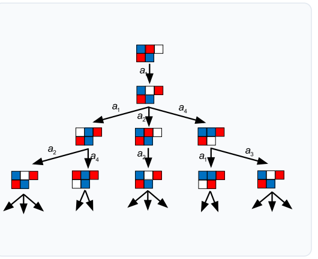

# Cviko 1

## Dekomponovat prompt na 6 klíčových komponent pro zajištění konzistentních výsledků.

- Persona (Role): Kdo model je? Simulace experta ořezává prostor možných

- odpovědí.

- Kontext (State): Vstupní data, historie, znalostní báze.

- Instrukce (Task): Co přesně se má stát (slovesa).

- Omezení (Constraints): Co model nesmí dělat. Často důležitější než instrukce.

- Příklady (Few-Shot): Ukázka "Input -\> Output" pro In-Context Learning.

- Formát výstupu: Specifikace syntaxe (JSON, Markdown, XML).

### Prompt Engineering

- Prompt Engineering není jen o hledání "magických slov". Je to systematický proces návrhu vstupu pro nedeterministický systém tak, abychom maximalizovali pravděpodobnost požadovaného výstupu.

## Vysvětlit vliv tokenizace a kontextového okna na výkon modelu.

- Token \!= Slovo.

- LLM nevidí "jablko", vidí vektor ID, např. \[4521, 12, 99\].

- Problém s čísly a kódem:

    - Číslo 9.11 může být tokenizováno jako 9, ., 11.

    - Číslo 9.9 jako 9, ., 9.

    - Proto modely často chybně tvrdí, že 9.11 \> 9.9 (protože 11 \> 9).

- Model nečte text lineárně jako člověk.

- Self-Attention: Každý token se "dívá" na všechny ostatní tokeny v kontextu a počítá váhu relevance.

- Toto vysvětluje, proč je kontextové okno limitované (kvadratická náročnost výpočtu u standardních transformerů).

- System Message: Imutabilní instrukce. Nastavuje "fyzikální zákony" konverzace. Má nejvyšší váhu.

- User Message: Proměnlivý vstup od uživatele.

- Assistant Message: Minulá odpověď modelu (pro zachování historie) nebo "Prefill" (vložení začátku odpovědi pro navedení modelu).

### Zero-Shot vs. Few-Shot

- Zero-Shot

    - Princip: Spoléháme pouze na trénovací data modelu.

    - Kdy použít: Obecné znalosti, kreativní psaní.

- Few-Shot (In-Context Learning)

    - Poskytujeme příklady přímo v promptu

    - Specifické formátování, unikátní doménový jazyk, klasifikace.

## Aplikovat pokročilé strategie usuzování (CoT, ToT) na složité logické úlohy.

- Chain of thought

    - Nutíme model verbalizovat myšlenkový proces před finální odpovědí.

    - Tj. ať píše co dělá

    - Transformer generuje token po tokenu. Pokud model musí rovnou napsat výsledek, nemá "čas" na výpočet. CoT poskytuje "výpočetní prostor".

    - Můžeme ho zapnout pomocí Zero-shot nebo manual:

        - Přidání fráze "Let's think step by step"

        - V příkladech (Few-Shot) ukážeme i postup řešení, ne jen výsledek.

- Tree of thought

    - Pro komplexní problémy, kde je potřeba plánování a backtracking.

        - Model generuje několik možných "dalších kroků".

        - Každý krok je ohodnocen (sebe-evaluace nebo externí skript).

        - Vybírá se nejlepší větev.

        - Aplikace: Psaní komplexního kódu, strategické plánování, kreativní psaní scénářů.

- Dekompozice Promptu

    - Rozbít úkol na podúkoly (Chaining).

    - Tím se snižuje kognitivní zátěž modelu v jednom kroku.

## Implementovat prompt inženýrské techniky ke zmírnění rizika halucinací.

- Definice: Generování fakticky nesprávné, ale sebevědomě znějící informace, která není podložena vstupním kontextem ani tréninkovými daty.

- Příčina: Modely jsou trénovány na maximalizaci pravděpodobnosti tokenu, nikoli pravdivosti. Optimalizují pro plynulost, ne pro faktickou přesnost.

- Kdy nastává:

    - Nedostatek informací v promptu (Zero-shot s prázdnou znalostní bází).

    - Příliš vysoká Teplota (Temperature).

    - Příliš dlouhé sekvence generovaného textu.

- Řešení

    - Grounding (Uzemnění)

        - Explicitně zakázat externí znalosti

            - Použij pouze kontext

    - Snížení teploty

        - 0.0 až 0.1

    - Sebe-kritika

        - Druhý prompt ověřuje výsledky

    - Vyžadujte citace

        - U RAG systémů vyžadovat, aby model uvedl zdroj.

### Optimalizovat prompty pro snížení nákladů a latence.

- Cena:

    - Input tokens jsou obvykle 3x-10x levnější než Output tokens.

- Strategie úspory:

- Být stručný v instrukcích (ale ne na úkor jasnosti).

- Omezit délku výstupu (max\_tokens).

- Používat odkazy místo kopírování textu (pokud má model přístup k webu/RAG).

### Kontextové Okno a "Lost in the Middle"

Modely si nejlépe pamatují začátek a konec.

### Latence a Caching

- Time-to-First-Token (TTFT): Jak dlouho trvá, než se začne vypisovat odpověď.

- Total Generation Time: Celkový čas.

- Prompt Caching (Anthropic, DeepSeek):

    - Pokud posíláte stejný velký kontext (např. celou knihu) opakovaně, API si ho může "nacachovat".

    - Snižuje cenu (až o 90 %) a latenci (až o 80 %).

    - Vhodné pro RAG systémy a chatování nad dokumenty

### Shrnutí

- Budoucnost a rozvoj: úspěch AI bude určovat schopnost vybudovat spolehlivé, měřitelné, ekonomicky udržitelné a odpovědné systémy.

- Od chatovaní k engineeringu: Aby byl prompt robustní, musí obsahovat specifické komponenty. Můžeme je přirovnat k parametrům funkce.

- Strategie ovlivňování: Dávat modelům příklady, vede k lepším výsledkům - Zero-Shot vs. Few-Shot, CoT a ToT.

- Halucinace se dá řídít (částečně): Díky parametrům systémových promptů, lze ovlivňovat jak moc jsou modely kreativní.

# Cviko 2

## Úspěch AI nebude určovat pouze to, jak chytré jsou modely.

Bude jej určovat schopnost vybudovat spolehlivé, měřitelné, ekonomicky udržitelné a odpovědné systémy.

## Pokročilé techniky: Stanford

- RLHF typ zarovnání dělá modely bezpečnějšími, ale snižuje rozmanitost výstupů a vede k „kolapsu módu“, kdy model opakuje pár bezpečných, stereotypních odpovědí

    - Učení ze zpětné vazby

    - Po spamování otázky začne být repetitivní

    - Dává přednost známým odpovědím.

- Verbalized sampling (VS)

    - Napíšeš hned, že chceš více vzorků, tj. nemá kontext z minulé zprávy jako nahoře.

## 5 top prompt strategií

- Constraint-Stacking Prompts

    - Experti neříkají modelu, aby prostě „psal lépe“.

    - Místo toho na sebe vrství omezení, která ho nutí k vyšším úrovním uvažování. Model je pak „ostřejší“, protože musí splnit více podmínek najednou.

- Reversal Prompts

    - Místo toho, aby odborníci model požádali, ať „dá správnou odpověď“, nechají ho nejdřív zkusit špatnou odpověď a teprve potom ji nechat opravit.

    - Tím se aktivuje kontrastivní uvažování.

- Perspective-Swap Prompts

    - Model otáčíte skrz více expertních perspektiv, aby se rozšířil jeho myšlenkový prostor.

    - Napiš mi to z pohledu x, y, z a pak je spoj.

- Scaffolding Prompts

    - Místo jednoho velkého promptu odborníci rozbijí úkol na navazující kroky. Model si nejdřív postaví vlastní plán, než začne generovat odpověď.

    - Rozděl mi to na kroky…

- High-Resolution Objective Prompts

    - Většina uživatelů zadává vágní cíle.

    - Odborníci „přiblíží detail“ tak, aby cíl nešlo špatně vyložit.

        **Příklad:**

        > „Napiš hero sekci landing page, která cílí na
        >
        > - mid-level produktové manažery ve fintech firmách
        > - kteří už selhali se 3 nástroji
        > - chtějí zaručený výsledek
        >
        > Zahrň: příslib, důkaz, mechanismus, CTA
        >
        > Maximálně 38 slov.“

## Role-Based Pattern

- Refactor

- Generace testů

- Fuzzer (divné vstupy do políček)

- Edge Case Detector

- Reviewer (nepřátelský pro lepší argumentaci)

## Jak šetřit peníze

Router: Levný model přesměrovává podle obtížnosti.

## Prompt vs Agent

- Chain je lineární (teplota 0)

    - A –\> B -\> C

- Agent je cyklický proces

    - Má cíl, ale cestu si hledá sám

- ReAct Loop

    - Thought – Action – Observation – Thought

    - Myšlenka (Toto nefunguje) – Akce (Volám service na log) – Výsledek (Nic tam není)

- Persona, Memory, Tools, Planning (rozložení kroků)

## MAS – Multi-Agent systém

Potřeba týmu.

## Kriticky zhodnotit rizika autonomních agentů.

Nekonečné smyčky

Halucinace nástrojů (neexistující params)

Destruktivní akce (poslání mailu)

Řešení je Human In The Loop – Schvalování

## Doporučení

1. Verzování v kodu

2. XML tagy

3. JSON nebo XML struktury

4. Testování promptu (Golden Dataset otázek)

5. Pravidla pro Systém a úkol pro Usera

6. Instrukce i na konec

7. Řetězení malých promptů

8. Negativní omezení (Neomlouvat se,…)

9. Teplota 0.0 až 0.7

10. Human in the loop

# Cviko 3

## Základní typy agentů

- Jednoduchý reflexní agent (Termostat)

    - Reaguje přímo na aktuální vjemy z prostředí

    - Nezohledňuje minulost ani budoucnost

- Modelově založený reflexní model (Mobilní robot, který si pamatuje polohu i po ztrátě signálu)

    - Udržuje vnitřní model prostředí, aby lépe reagoval na částečné pozorovatelné situace.

    - Bere v úvahu předchozí stavy.

- Cílově orientovaný agent (Autonomní vozidlo, které plánuje trasu)

    - Kromě vjemů a stavů prostředí zohledňuje také dlouhodobý cíl.

    - Plánuje akce, aby se přiblížili k dosažení cíle.

- Užitkově orientovaný agent

    - Rozdíl od cílové je v tom, že tento bere akci, která má největší užitek.

- Učící se agent (Program hrající šachy, který se zlepšuje)

    - Dokáže se zlepšovat na základě zkušeností a zpětné vazby.

    - Optimalizuje své chování v čase prostřednictvím učení.

## Klíčové prvky potřebné pro činnost agenta

- Vnímání – agent potřebuje informace z prostředí.

- Akce – agent musí být schopen ovlivňovat prostředí.

- Cíle – agent potřebuje jasně definované cíle.

- Model prostředí – agent musí rozumět svému prostředí.

- Rozhodování – agent potřebuje strategii, jak zvolit akci.

## Vlastnosti prostředí

- Pozorovatelnost

    - Plně – Šachy

    - Částečně – Poker

    - Agent ne/musí udržovat vnitřní stavy a pracovat s nejistotou.

- Stochastičnost (Nedeterministické)

    - Deterministické – Rubikova kostka

    - Stochastické – Kostky

    - Agent ne/musí pracovat s nejistotou

- Sledovost (Je ovlivněno minulými kroky)

    - Epizodické – Automatický vysavač

    - Sekvenční – Autonomní vozidlo – Ke ovlivněno minulými kroky

- Dynamika (Změna v čase)

    - Statické – Sudoku – Mám hodně času

    - Dynamické – Autonomní řízení

    - Semi-dynamické – Systém řízení zásob

- Granularita (Oddělené kroky)

    - Diskrétní – Oddělené kroky a stavy - Šachy

    - Spojité – nejsou jasně oddělené kroky – Let dronem

## Zjednodušení problému

Diskretizace prostředí (na mřížku)

Změna granularity

Zanedbání překážek

Zanedbání stoch. Vlivů

Zjednodušení akčního prostoru

Zanedbání dynamiky prostředí

## Význam simulace

Lepší testování.

## Formulace problému

- Počáteční stav

- Sada možných akcí

- Přechodová funkce

- Cílový stav

- Kritérium úspěchu

- Omezení

### Míra zranitelnost

- Jeden stav

    - Agent ví přesně co se stane

    - Rameno na lince

- Více stavů

    - Agent musí pracovat s nejistotou

    - Diagnózy na základě příznaků

- Stochastický

    - Stavy mají pravděpodobnost

    - Zasetí plodiny na poli

- Explorativní

    - Omezené znalosti

    - Agent se musí učit

# Cviko 4

## Přechodový systém

Základní definice

- (S, T) – Stavy a přechody

Popis pro agenty

- (S, A, y(s, a)) – Stavy, akce a přechodovou fci

- Pro plánování přidat ještě počátky a konce (I a G)

    

## Deterministické plánování

Plán - Posloupnost akcí vedoucím z počátku do cíle.

Návrh strategie – Zabránit cykly, stromová nebo grafová

Hodnocení – Existuje řešení, hodnocení náročnosti, vyjádření náročnosti

## Prohledávání

### Do šířky

Ukládání FIFO – fronta, testuje se každý nový stav po získání

Najde nejkratší

Paměťově náročné

### Do hloubky

Ukládání LIFO – zásobník, úprava kontroly duplicity výsledku

Nezaručuje nejkratší cestu, ale první nalezenou

Nízká paměťová náročnost (větve \* délka nejdelší cesty)

# Cviko 5

- Porozumět rozdílům mezi strategií a plánem agenta.

    - Strategie jak se agent rozhoduje a jedná ve vztahu k ostatním agentům.

    - Plán je sekvence akcí, které agent musí splnit pro dosažení cíle.

- Definovat ryzí, smíšenou a dominantní strategii.

    - Ryzí strategie

        - Konkrétní a jednoznačný plán, který určuje, jaké akce agent provede v každé možné situaci

    - Smíšená strategie

        - Agent má několik ryzích strategií a volí mezi nimi s pravděpodovností

    - Dominantní strategie

        - Strategie, která přináší agentu nejlepší možný výsledek bez ohledu na to, jakou strategii zvolí ostatní agenti

- Vysvětlit koncept Nashovy rovnováhy a Paretova optima.

    - Nashova rovnováha popisuje stav, kdy žádný agent nemůže zlepšit svůj užitek jednostrannou změnou své strategie za předpokladu, že ostatní agenti své strategie nemění.

    - Paretovo optimum je stav, ve kterém není možné zlepšit užitek jednoho agenta bez současného snížení užitku alespoň jednoho jiného agenta.

- Minimax

    - Prohledávací algoritmus pro deterministické hry s úplnou informací, vybraný k minimalizaci maximální možné ztráty.

    - hledáme optimální strategii pro hráče MAX, který maximalizuje užitek, zatímco MIN jej minimalizuje.

- Alfa-Beta ořezávání

    - Optimalizační technika pro algoritmus Minimax, která eliminováním nerelevantních větví zrychluje prohledávání

    - Alfa je nejlepší hodnota hráče MAX (nejvyšší hodnota)

    - Beta je nejlepší hodnota hráče MIN (nemenší hodnota)
